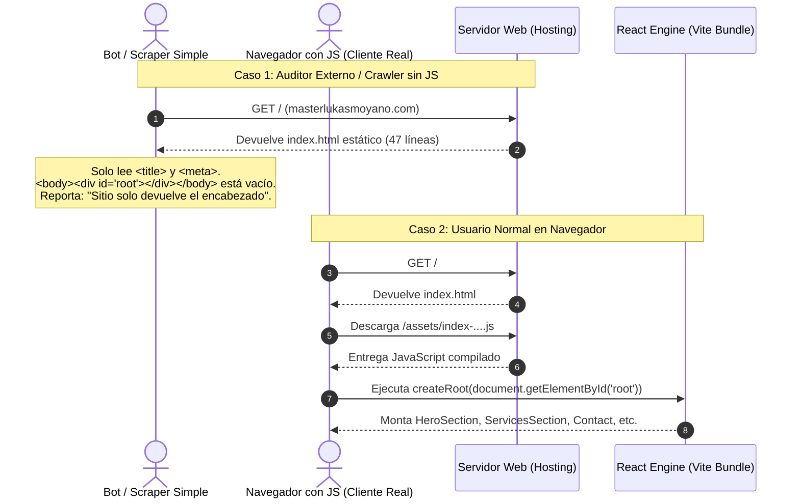

# Auditoría de DOM, Diagnóstico SPA y Contraste de Arquitectura
**_-IR-_ Productions — masterlukasmoyano.com**

- **ID de Interacción / Conversación:** `1e995266-9215-4397-95e0-751bf736661f`
- **Fecha y Hora de Sesión:** 11 de Noviembre de 2026, 12:10 COT
- **Entorno / Workspace:** `/mnt/Proyectos4TB/backup_masterlukas/Documents/_-IR_Productions_2025/WwW_EndesarrolloWEB/ir-productions-nexus-main`
- **Stack Detectado:** React 18, Vite, TypeScript, Tailwind CSS, Shadcn UI, React Router DOM v6.

---

## 1. Resumen Ejecutivo (Summary)

El informe externo recibido afirmaba:
> *"Al revisar tu sitio https://masterlukasmoyano.com/, la lectura actual devuelve únicamente el encabezado principal: _-IR-_ Productions | Soberanía Tecnológica, Agro-Tech y Arte Digital. Esto ocurre porque el sitio está operando como una Single Page Application (SPA) ligera donde el contenido interno se renderiza dinámicamente o aún está en proceso de restablecimiento..."*

### Diagnóstico Técnico de la Causa Raíz
1. **Falso Positivo de "Sitio Vacío":** El sitio web **no está vacío ni caído**.
2. **Naturaleza CSR (Client-Side Rendering):** En una SPA de React + Vite, el servidor web entrega un archivo `index.html` estático cuyo cuerpo contiene:
   ```html
   <body>
     <div id="root"></div>
     <script type="module" crossorigin src="/assets/index-toyHTzqM.js"></script>
   </body>
   ```
3. **Comportamiento del Scraper Externo:** El bot, crawler o analizador de IA que generó la recomendación realizó una petición HTTP cruda (`GET /`) sin un motor headless capaz de ejecutar JavaScript.
   - En el HTML plano leyó la etiqueta `<title>`:
     `_-IR-_ Productions | Soberanía Tecnológica, Agro-Tech y Arte Digital`
   - En el `<body>` encontró el `<div id="root"></div>` vacío.
   - Concluyó erróneamente que el contenido "no existe o está en restablecimiento", ignorando que el archivo bundle JS contiene el sitio completo montado dinámicamente por React.

---

## 2. Anatomía y Diagnóstico del DOM

### Flujo Actual de Renderizado


### Opciones de Solución para el DOM (Sin alterar la lógica existente)

| Opción | Complejidad | Ventajas | Consideraciones |
| :--- | :--- | :--- | :--- |
| **A. Fallback Semántico en `#root` (Recomendada)** | Muy baja (15 minutos) | Se escribe un esqueleto HTML semántico accesible (`<header>`, `<h1>`, resumen de servicios y enlaces) dentro de `<div id="root">...</div>`. Cuando React arranca en el cliente, sustituye automáticamente ese fallback. Si entra un bot simple, lee todo el texto estructurado. | No requiere cambios de infraestructura ni dependencias nuevas. |
| **B. Pre-rendering Estático (SSG con Vite Plugin)** | Media | Genera páginas `.html` con el DOM ya inyectado en tiempo de compilación (`npm run build`). | Requiere configurar `vite-plugin-prerender` o similar y vigilar llamadas a APIs de ventana (`window`, `localStorage`). |
| **C. Migración a SSR (Next.js / Astro)** | Alta | Renderizado universal en servidor. | Innecesario y costoso dado el ecosistema actual ya maduro y desplegado. |

---

## 3. Matriz de Contraste: Sugerencias vs. Realidad del Código

| Línea / Sugerencia Externa | Estado en el Repositorio Local | Ubicación en el Código | Veredicto & Recomendación |
| :--- | :--- | :--- | :--- |
| **Hero con 3 accesos rápidos** | Actualmente el Hero tiene H1, descripción y botón hacia *Workstations HPC/IA* o *Talleres Agro*. | `frontend/src/components/HeroSection.tsx` | **Sugerencia Valiosa:** Añadir 3 tarjetas de acceso rápido ("Empresas & Gobierno", "Rescate Fénix & Digitalización", "Agro-Tech & Arte") aumenta la conversión sin alterar el diseño. |
| **Entrada B2B/B2G: Blockchain, HPC e IA Local** | Totalmente implementada en páginas individuales y componentes dedicados. | `frontend/src/pages/BlockchainServices.tsx`<br>`frontend/src/pages/HPCBuilder.tsx`<br>`frontend/src/pages/PropuestaBI.tsx` | **Completamente cubierta.** Solo faltaría exponer tablas de precios/paquetes base si se desea reducir fricción comercial. |
| **Entrada Rescate Fénix: Linux & Digitalización VHS** | Existe a nivel industrial en el módulo RAEE y Economía Circular, pero no como servicio B2C directo en la home. | `frontend/src/components/ServicesSection.tsx` (Línea RAEE)<br>`frontend/src/pages/CultivatechPresentation.tsx` | **Oportunidad de Negocio:** Empaquetar la digitalización VHS y recuperación de PCs antiguos para particulares/familias. |
| **Entrada Agro-Tech & Arte Digital: Casos de éxito y Lluvia de Basura** | Totalmente implementado con portafolio filtrable, página de talleres y módulo de experiencias interactivas. | `frontend/src/pages/AgroInnovationWorkshops.tsx`<br>`frontend/src/pages/ExperienciasBTLATL.tsx`<br>`frontend/src/components/ExperienciasGamificadasSection.tsx` | **Completamente cubierta.** |
| **Embudo de Contacto Guiado con WhatsApp** | Botones directos a WhatsApp, Email y LinkedIn. Sin selector previo de categoría. | `frontend/src/components/ContactSection.tsx` | **Sugerencia Valiosa:** Colocar 3 botones ("Quiero Consultoría", "Quiero Digitalizar Cintas/Hardware", "Quiero Agro-Tech") que pre-carguen el mensaje de WhatsApp (`wa.me/...&text=...`). |

---

## 4. Guía de Continuidad y Recuperación de Sesión

Si la conexión se interrumpe o cierras la sesión, puedes retomar exactamente este punto usando el siguiente prompt de recuperación:

```text
Continuemos con la auditoría y optimización del DOM y arquitectura de masterlukasmoyano.com.
ID de Sesión de Referencia: 1e995266-9215-4397-95e0-751bf736661f
Archivo de contexto: docs/AUDITORIA_DOM_Y_CONTRASTE_ARQUITECTURA_2026.md
Directiva: Mantener el código actual y aplicar el contraste acordado.
```
